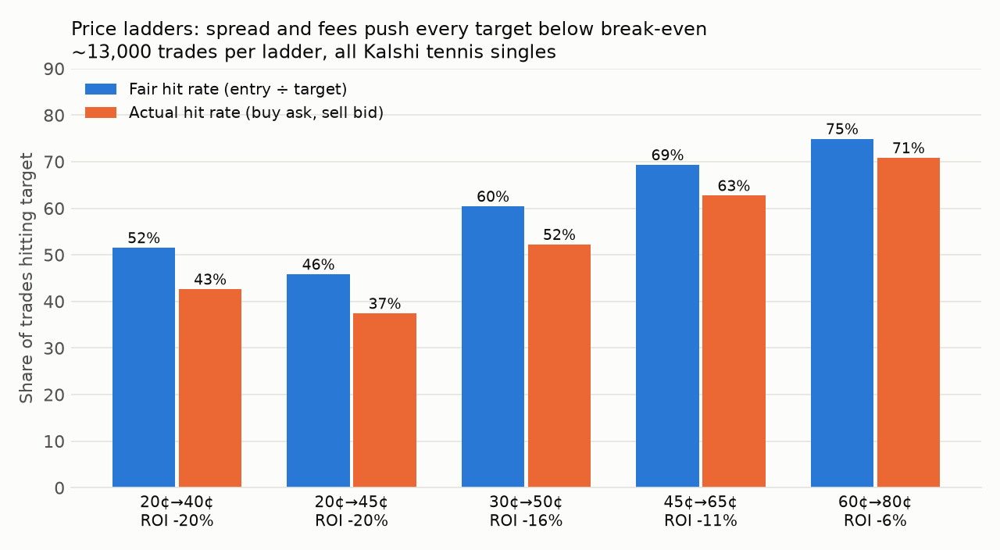
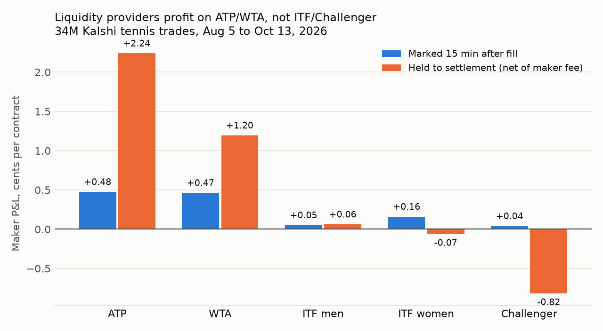

# OrderFlow

**Testing trading ideas on Kalshi tennis markets against 14,000 matches and 34M trades.**

I traded Kalshi's in-play tennis markets by hand and had a stretch where it looked like I'd found something. Before automating it, I wanted to know whether it was skill or variance. This repo tests that question, and the follow-up ideas, against the full market.

**Short version**

- My own trades showed no edge overall. They broke even before fees, and the fees made it a loss.
- Every *price-based taker strategy* I tested lost money after fees, on 12,793 matches with an out-of-sample holdout: buying the drop, buying after the drop settles, swing trading, and price ladders (20¢→40¢ etc.). The losses ran from -6% to -20%.
- Across **34 million trades**, *liquidity providers* (makers) earned money on ATP and WTA markets, about +0.5¢ per contract within 15 minutes and +1.2 to +2.2¢ held to settlement. On ITF and Challenger markets, they didn't.
- Next step: a paper-trading market maker for ATP and WTA, to measure what a new entrant at the back of the order queue actually earns.

---

## Data

All data comes from Kalshi's public market-data API. **No data is included in this repo.** The `pipeline/` scripts download it.

| Dataset | Size | Source |
|---|---|---|
| Settled tennis singles markets (ITF M/W, ATP, WTA, Challenger) | 14,149 matches, Aug 5 to Oct 13, 2026 | `GET /markets`, `/historical/markets` |
| 1-minute bid/ask/last/volume candles | 4.2M rows | `.../candlesticks` |
| Every trade, with taker side | ~34M trades | `GET /markets/trades`, `/historical/trades` |
| Liquidity reward programs (all of Kalshi) | 287K programs | `GET /incentive_programs` |

One market per match is used, since the other player's market is the mirror image (`P(B) ≈ 1 − P(A)`).

---

## Part 1: Was my own trading skill or luck?

Analyzed my Kalshi realized P&L export (188 positions, Feb to Oct 2026). The test is simple: on Kalshi the price *is* the market's probability, so an edge means winning more often than the price implied.

- **No edge overall.** The gross return was -2%, with a bootstrap 95% CI of -19% to +14%. Fees were about 60% of the net loss.
- **Favorites vs. longshots.** Positions entered at 45¢ or above returned +13%. Those under 45¢ returned -27%. This is the classic longshot bias.
- **Timing within a match.** Buying *while the price was still crashing* (filling at or below the prior minute's bid) returned -42%. Buying after a drop had *stopped* looked positive on my 13 matches. Part 2 tests whether that holds up.
- **The good stretch** was a run of small parlays and a few days of ITF tennis. It's consistent with variance at that sample size.

Code: `analysis/my_trades_overview.py`, `analysis/my_trades_match_state.py`.

---

## Part 2: Do the obvious strategies work on the whole market?

Every rule below was run mechanically on all usable matches (12,793). Entries use the **next minute's** quote after the signal, so there's no lookahead. Taker fees use Kalshi's formula `ceil(0.07 × C × P × (1−P))`. Months are split into **Aug** (exploration) and **Sep to Oct** (holdout). CIs are match-level bootstraps.

### Fade the drop, hold to settlement

| Rule (taker, $10 per trade) | All | Sep-Oct men | Sep-Oct women |
|---|---|---|---|
| Random in-play entry (baseline) | -16.7% | -16.8% | -17.3% |
| Buy immediately after a 15¢ drop | -9.8% | -12.2% | -10.0% |
| Buy after the 15¢ drop *settles* | -11.5% | -12.4% | -14.3% |
| Same, entries 20 to 65¢ only | -7.5% | -7.8% | -10.9% |

The drop signal beats random by 5 to 10 points, but it never covers spread and fees. The best-looking August filter (women, buy immediately, 20 to 65¢) went from -1.0% in August to -9.0% in the holdout. That's overfitting caught by the holdout.

### Swing trading: sell into the bounce

After a 15¢ drop, the mid price 5, 15, and 30 minutes later moved by **-0.5¢ to +0.3¢ on average**, so there is no systematic bounce. Taking profit at +3, +5, or +10¢ (or exiting after 30 minutes) returned -11% to -14% as a taker, and -1% to -3% even assuming free maker fills both ways. The +3¢ target hits around 73% of the time, which feels like it works, but the misses are larger than the wins.

### Price ladders (buy ~20¢, sell at 40¢, and so on)



If a price is fair, the chance it reaches a higher target before going to zero is just `entry ÷ target`. So **no take-profit or stop-loss combination has positive expected value on a fair price.** Buying at the ask and selling at the bid pushes the real hit rate 4 to 9 points below fair, and every ladder loses money.

Code: `analysis/backtest.py`, `analysis/swing.py`, `analysis/ladder.py`. Full tables are in `results/`.

---

## Part 3: Who makes money, then?

If takers lose, someone is on the other side. For every trade, I identified the maker (the resting order that got hit) and marked their position to the mid price 1, 5, 15, and 60 minutes later, and to the final result.



| Tour | Spread captured at fill | After 15 min | Held to settlement (net of maker fee) |
|---|---|---|---|
| ATP | +0.82¢ | +0.48¢ | **+2.24¢** |
| WTA | +0.92¢ | +0.47¢ | **+1.20¢** |
| ITF men | +1.73¢ | +0.05¢ | +0.06¢ |
| ITF women | +1.74¢ | +0.16¢ | -0.07¢ |
| Challenger | +1.06¢ | +0.04¢ | -0.82¢ |

- **ITF** has wide spreads, but adverse selection eats nearly all of the spread within 15 minutes. The flow crossing the spread there is informed, likely by faster score data.
- **ATP and WTA** have tighter spreads, but makers *keep* the edge and it grows over time. The flow there is mostly retail.
- Maker P&L was positive in each of August, September, and October.
- This lines up with Bartlett (2026), *Adverse Selection in Prediction Markets: Evidence from Kalshi*, which finds makers are cross-subsidized by traders overbetting YES, and that single-name markets carry more informed flow.

**Liquidity rewards:** none of Kalshi's 287K reward programs (Sep 2025 to Dec 2026) covered tennis match markets. Table tennis match markets carried $20 per match for about 12,000 matches between August and October.

Code: `analysis/maker_test.py`, `analysis/combine_maker.py`. Full breakdown in `results/maker_results.txt`.

### Caveats

- These are **averages across all makers**, including those at the front of the queue. A new entrant at the back of the queue gets filled disproportionately on toxic flow, so the real number will be worse. That's what the paper-trading phase measures.
- The trades endpoint was paged per market. In a sampled chunk, about 6% of rows were exact duplicates (some genuine multi-maker fills, some possibly paging overlap). This affects weighting, not the per-contract averages.
- The in-play start is detected from price and volume activity, not from official match times.
- Taker-strategy results use 1-minute candles. Real fills inside the minute could be better or worse.

---

## Reproduce

```bash
pip install -r requirements.txt

# 1. data (standard library only, resumable; several hours in total)
python3 pipeline/fetch_markets_candles.py --since 2026-06-01   # -> bt_markets.csv, bt_candles.csv
python3 pipeline/fetch_trades_rewards.py                        # -> bt_trades.csv, bt_incentives.csv

# 2. taker strategy backtests
python3 analysis/backtest.py bt_candles.csv bt_markets.csv trades_out.csv
python3 analysis/swing.py    bt_candles.csv bt_markets.csv
python3 analysis/ladder.py   bt_candles.csv bt_markets.csv

# 3. maker analysis (streams the trades file; can be split into chunks)
python3 analysis/maker_test.py bt_trades.csv bt_candles.csv bt_markets.csv agg_00.pkl
python3 analysis/combine_maker.py "agg_*.pkl"
```

To analyze your own history, export a realized P&L CSV from Kalshi, then run `analysis/my_trades_overview.py <csv> positions_out.csv`. For match-state context, also run `pipeline/fetch_my_trade_markets.py <csv>`.

`swing.py` and `ladder.py` reuse helper functions from `backtest.py`, so keep the three files in the same folder.

## Roadmap

- [x] Personal trade analysis
- [x] Taker strategy backtests with holdout
- [x] Market-wide maker analysis
- [ ] Repeat the maker analysis on other Kalshi sports to find the best venue
- [ ] Paper market maker (live order book, simulated queue position) on ATP/WTA for two weeks
- [ ] Small live deployment if paper results hold

---

*Research project, not financial advice. Uses Kalshi's public API. Respect Kalshi's terms of service and rate limits.*
